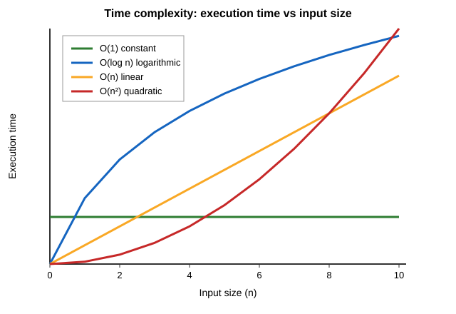

# Introduction to algorithms

## What is an algorithm?

- An algorithm is a step-by-step procedure for solving a problem
- Algorithms are not tied to a programming language. The same algorithm can be written in Java, Python, or pseudo code (simple code that is not specific to any programming language)
- The same problem can often be solved in several ways, and the solutions can differ a lot in speed
- For example, checking whether a value exists in an `ArrayList` and in a `HashMap` gives the same answer, but the time the operation takes increases differently as the size of the data structure grows

## Evaluating performance of an algorithm

- The performance of an algorithm (i.e. a method) can be measured by its execution time. However, this only provides the time the execution took on specific hardware with specific arguments (e.g. a specific array)
- Instead, we usually analyze how **the running time grows when the input grows** (e.g. the number of elements in the argument array)
- The input size is usually called `n` and the **time complexity** "big O" notation describes the worst case running time based on the `n`
- Here are examples of time complexities of common operations with the big O notation:
  - A single statement, arithmetic operation, or array access is `O(1)`
  - A loop over all `n` items is `O(n)`
  - A loop inside another loop, both over `n` items, is `O(n²)`

```java
// Time complexity of this algorithm is O(1)
public int findFirstElement(int[] arr) {
    return arr[0];
}

// Time complexity of this algorithm is O(n)
public int sum(int[] arr) {
    int total = 0;
    for (int value : arr) {
        total += value;
    }
    return total;
}

// Time complexity of this algorithm is O(n²)
// Returns the sum of the products of every pair of values in the array
public int sumOfAllProducts(int[] arr) {
    int total = 0;
    for (int i = 0; i < arr.length; i++) {
        for (int j = 0; j < arr.length; j++) {
            total += arr[i] * arr[j];
        }
    }
    return total;
}
```

## Comparing the time complexity

- The time complexity of an algorithm describes its performance. For example, `O(n)` algorithms are more performant than `O(n²)` algorithms
- Algorithms with poor performance can still have a reasonable execution time with a small input size. However, we want algorithms to scale well, so that when the input size grows, the execution time doesn't grow rapidly
- The graph below shows how execution time grows as the input size grows
- `O(1)` stays flat, `O(log n)` grows slowly, `O(n)` grows in a straight line, and `O(n²)` grows much faster as `n` increases




