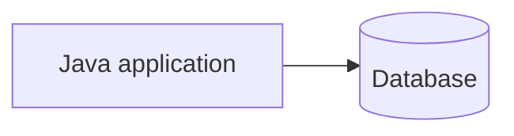
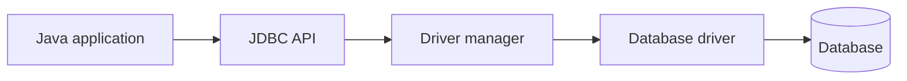

# Introduction to database programming

## Why we need database programming?

- Data in variables and collections such as `ArrayList` and `HashMap` exists only while the program is running. When the program stops, the data is lost
- A **database** stores data permanently, so it is still available the next time the program starts
- Databases also help us organize large amounts of data, share it between many programs or users, and search it efficiently
- **Database programming** means writing programs that read data from a database, write new data to it, and update or delete existing data
- We use database programming to **implement more complex logic that interacts with databases**. Almost every application we use, such as Moodle and Microsoft Teams, relies on programs that communicate with databases to store, retrieve, and manage data

## SQLite



- To connect to a database, we typically need a database management system, such as PostgreSQL, running either on our computer or on an external server
- In our examples, we will use **SQLite**, a lightweight relational database management system that supports SQL
- Unlike PostgreSQL, SQLite does not require a separate database server. The entire database is stored in a single file on our computer
- SQLite is well suited for local data storage, and applications that don't require multiple users to access the database simultaneously

## Database communication with Java

- A Java program communicates with a database through a **connection**. The connection is like a pipe between the program and the database
- To create a connection, the program needs a **connection string** (URL) that tells where the database is and how to reach it
- Through the connection, the program sends **SQL queries** to the database and receives the results back
- Each database system (e.g. SQLite, MySQL or PostgreSQL) has its own way of communicating over the network or the file system. A **driver** is a program that knows these details
- Java does not include drivers for all databases. Instead, we add the driver is a external **dependency** specified in the `build.gradle` file and downloaded by Gradle
- The driver is what actually talks to the database. Our Java code uses the same standard methods regardless of which driver is used



## Java Database Connectivity (JDBC)

- **JDBC** (Java Database Connectivity) is a standard API built into Java in the `java.sql` package
- JDBC defines the common interfaces that our code uses, such as `Connection`, `Statement` and `ResultSet`. The actual database driver implements them
- Because the interfaces are the same for every database, we can switch from one database to another with little change in our code. Only the connection URL and the driver dependency change
- A typical JDBC program follows these steps:
  1. Open a connection with `DriverManager.getConnection(connectionString)`
  2. Create a statement with the SQL query
  3. Execute the query
  4. Read the results, if the query returns any
  5. Close the connection

```java
// Connection string specifies where the database is located and how to connect to it
// With SQLite, the connection string is the path to the database file
String connectionString = "jdbc:sqlite:src/main/java/lesson6/data/db.sqlite";
// With e.g. MySQL it specifies the database server address, database name and the credentials:
// jdbc:mysql://localhost:3306/my_database?user=myUser&password=myPassword

// 1. Open a connection
Connection connection = DriverManager.getConnection(connectionString);

try {
    // 2. Create a statement
    Statement statement = connection.createStatement();
    // 3. Execute the query
    ResultSet resultSet = statement.executeQuery("SELECT * FROM countries");

    // 4. Read the result rows
    while (resultSet.next()) {
        // Value of the row's name colummn
        String name = resultSet.getString("name");
        System.out.println(name);
    }

    // 5. Close the connection
    connection.close();
} catch (SQLException e) {
    e.printStackTrace();
}
```

## Data Access Object (DAO) pattern

- A **DAO** (Data Access Object) is a class that hides the database details behind simple methods. The rest of the program calls methods such as `addCountry` or `findAllCountries` and does not need to know any SQL or JDBC
- A DAO class usually handles one database table. For example, a `CountryDAO` handles the `countries` table
- The DAO pattern separates the **data access logic** (how data is stored and fetched) from the **business logic** (what the program does with the data)
- Using a DAO makes the code easier to read and maintain. If the database or the queries change, only the DAO class needs to be updated
- The DAO pattern also makes it easier to test the business logic, because it can be separated from the database

```java
CountryDAO countryDAO = new CountryDAO();

countryDAO.addCountry(new Country("Finland", 5_600_000));

// The caller only uses the methods of the DAO. The SQL is hidden inside the class
List<Country> countries = countryDAO.findAllCountries();
```
