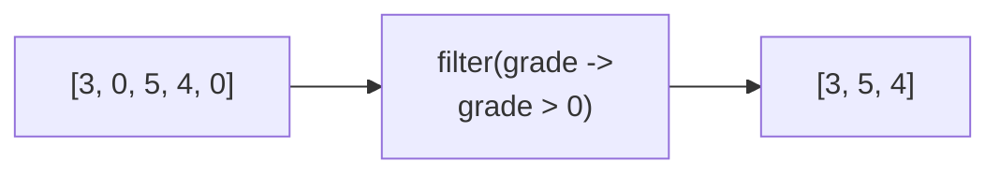
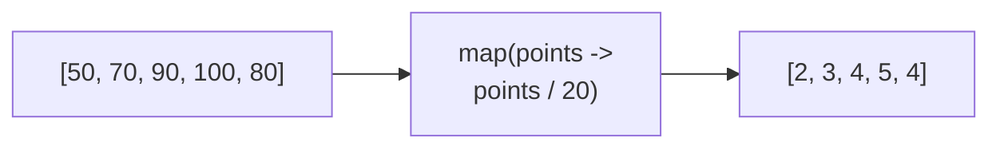

# Introduction to streams

## What is a stream?

- A **stream** is a sequence of values that can be processed one value at a time
- In Java, a stream is not a data structure that stores values. It processes values from a source, such as a list
- Streams are useful when we want to describe a sequence of operations on a collection
- A stream does not usually change the original collection. Instead, the operations produce a new result
- Stream operations can be written in a **declarative** style: we describe **what should happen** rather than every step needed to make it happen. Similar declarative style is in e.g. SQL queries
- For example, suppose that `grades` list contains students' grades. We can select passing grades with a stream:

```java
List<Integer> grades = List.of(3, 0, 5, 4, 0);

// Streams are declarative, describing what should happen with the stream elements in each step
List<Integer> passingGrades = grades.stream()
        // grade > 0 describes the condition for keeping elements on a stream
        .filter(grade -> grade > 0)
        // Collect the stream elements to a list
        .toList();
```

```sql
-- Style of SQL queries is similarly declarative, describing the desired outcome
SELECT grade
FROM CourseGrade
WHERE grade > 0;
```

## Lambdas and streams

- A **lambda expression** is a short way to represent a function
- Stream operations receive lambdas to describe what to do with each element
- In `grade -> grade > 0`, `grade` is the input and `grade > 0` is the result
- The lambda is applied to each element in the stream
- Common stream operations, such as `filter` and `map`, receive one lambda and apply it to the stream elements

## Operations of streams

A stream pipeline usually has three parts:

1. A **source** initializes the stream, for example a list
2. **Intermediate operations** process the stream, for example `filter`
3. A **terminal operation** finishes the pipeline, for example `toList`

```java
List<String> names = List.of("Ada", "Linus", "Grace");

// names list is the stream source
List<String> longNames = names.stream()
        // filter is a intermediate operation   
        .filter(name -> name.length() > 3)
        // toList is the terminal operation
        .toList();                            
```

## Filter stream elements

$$
\underbrace{\texttt{grade}}_{\text{Element on stream}}
\quad\longrightarrow\quad
\underbrace{\texttt{grade > 0}}_{\text{Condition for keeping an element}}
$$

- The `filter` operation keeps the elements for which its lambda returns `true`. Elements for which the lambda returns `false` are removed from the stream

```java
List<Integer> grades = List.of(3, 0, 5, 4, 0);

List<Integer> passingGrades = grades.stream()
        // Only keep grades larger than 0 on the stream
        .filter(grade -> grade > 0)
        .toList();
```



## Map (transform) stream elements

$$
\underbrace{\texttt{points}}_{\text{Element on stream}}
\quad\longrightarrow\quad
\underbrace{\texttt{points / 20}}_{\text{How to transform an element}}
$$

- The `map` operation transforms every element by applying its lambda. Unlike `filter`, `map` does not remove elements: one input element produces one output element

```java
List<Integer> examPoints = List.of(50, 70, 90, 100, 80);

List<Integer> grades = examPoints.stream()
        // Transform exam points to a grade by dividing by 20, e.g. 100 => 5
        .map(points -> points / 20)
        .toList();
```

